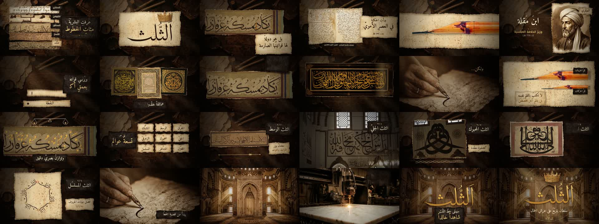

# Example — «خط الثلث: التاج والميزان» (Thuluth: the Crown and the Scale)

A 3:56 Arabic documentary motion-graphics film built entirely with this system. It's the quality bar for
new films.

- 🎬 **Watch:** [`thuluth_final_720p.mp4`](thuluth_final_720p.mp4) (in this folder) ·
  1080p: https://github.com/zoih6/thuluth-motion-film/releases/tag/v3.0
- Full production repo (all iterations, assets, scripts): https://github.com/zoih6/thuluth-motion-film (branch `v3`)
- `contact.jpg` = one frame every 10 s · `poster.jpg` = finale frame

## Brief
VO (Arabic, 236 s) on the Thuluth script: why it is the "crown" of Arabic scripts, its laws, its origin
(Qutba al-Muharrir → Ibn Muqla → Ibn al-Bawwab), its Ottoman peak (Hafiz Osman, Mehmed Şevki), why it is
the hardest, harakat and "haml", its nine "worlds" (sub-styles), and its digital present. VOX-style
motion graphics, 16:9, sample first, real assets, GitHub delivery in parts, clean workspace.

## Core metaphor
The **rhombus dot (نقطة)** — the calligrapher's unit of measure. It measures letters, stacks into rulers,
builds geometry, and returns as the jewel of the crown in the finale. The **crown** = "the crown was placed on
only one script".

## Iterations (what changed and why — read `../../library/user_feedback_patterns.md`)
| version | style | client verdict |
|---|---|---|
| v1 | paper collage, procedural shapes, generated calligraphy | approved sample, but asked for real assets & portraits |
| v2 | real manuscripts + AI miniature portraits | approved sample; then sent new style references |
| v3 | **Sepia Manuscript Cinema** (dark desk plates, god rays, torn parchment, painterly sepia portraits, gold geometry) | "wow, amazing" ✅ |

## Section map (VO seconds)
| section | time | visual thesis |
|---|---|---|
| S1 hook | 0–20.14 | hand writes → real script strips → crown lands on «الثلث» → greatest/most beautiful/hardest |
| S2 laws | 20.14–32.64 | a real Ottoman panel becomes a blueprint: dot rulers, baselines, "not a calligrapher" |
| S3 origin | 32.64–48.64 | Hijazi folio, Qutba's portrait + Tumar strip, penknife cuts the reed: nib = ⅓ → the name |
| S4 masters | 48.64–67.34 | Kufic page, Ibn Muqla (dots + compass circle on a real alif), Ibn al-Bawwab under a loupe, foundations |
| S5 Ottoman | 67.34–81.76 | Istanbul skyline, real works of the giants, Hafiz Osman & Mehmed Şevki portraits |
| S6 hardest | 81.76–103.44 | an ink blot ruins a line, real gilded celî panel, line/circle/square compositions |
| S7 harakat | 103.44–131.46 | two pens (¼ width), interlacing, balance, void/fill → «الحَمل» |
| S8 nine worlds | 131.46–188.92 | 9-card grid, then each style on a real specimen with a specific overlay |
| S9 today/finale | 188.92–236 | archive → reed → scanner → vector curves → mosque scale → tablet/AI → laser on marble → gold word + crown |

## Files
- `code/` — the actual v3 scene code (`core3.js` = the engine this skill's `engine/core.js` was generalised
  from; `sc12.js` … `sc89.js` = sections; `ink3.js` = stroke-order ink reveal; `cues_v3.json` = SFX sheet).
  Asset paths refer to the production repo.
- `STYLE_v3.md` — the style bible · `treatment.md` — the original treatment (v1) ·
  `vo_word_timings.json` — word-level timings (the master clock).

## Numbers
7080 frames @30 fps · rendered in 5 parts of 36–48 s (≈55 s per 6 s chunk on 2 vCPU) · 1080p 105 MB,
720p 49 MB · −14.3 LUFS · ≈60 shots · 12 AI images (plates/portraits/objects) + ~20 real artefacts.
